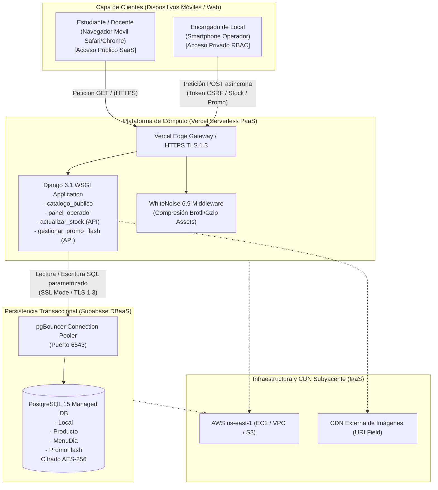
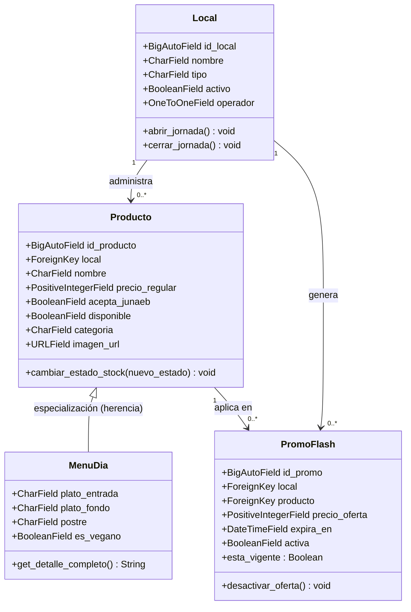
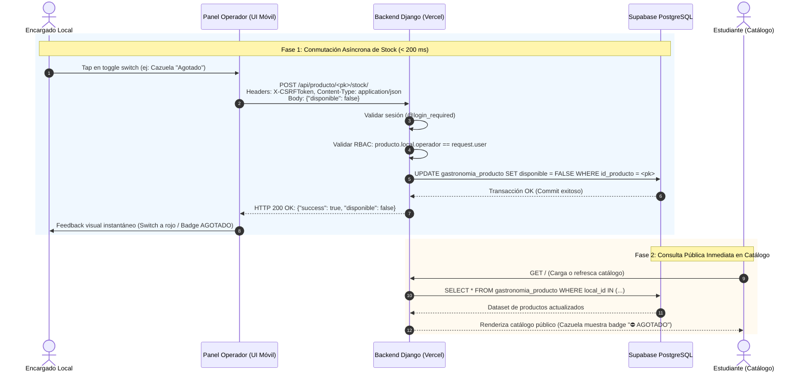
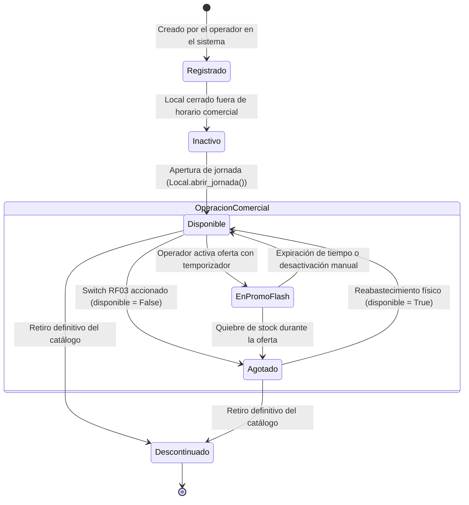

# Dossier de Contexto Completo del Proyecto
## Sistema Centralizado de Publicación y Consulta Gastronómica — INACAP Sede Renca

---

### 📋 Ficha Técnica Institucional
* **Institución:** INACAP — Sede Renca (Santiago de Chile, 2026)
* **Carrera / Asignatura:** Ingeniería de Software
* **Docente Evaluadora:** Oscarina Sanabria
* **Equipo de Desarrollo:** 
  * **Angelo Zamora** — *Product Owner / Cloud & Core Developer*
  * **Martín Tapia** — *Scrum Master / Backend & Security Developer*
  * **Yoshua Castillo** — *Frontend / UX Mobile-First Developer*
  * **Vicente Sagredo** — *QA Tester / Core Developer*
* **Calificación Obtenida:** **Nota 7.0** (125 / 125 puntos en la Evaluación Sumativa 3)
* **Repositorio Oficial en GitHub:** [https://github.com/sicosis3dfx/inacap-gastronomico-proto/](https://github.com/sicosis3dfx/inacap-gastronomico-proto/)
* **Despliegue en Producción (Cloud PaaS):** [https://inacap-gastronomico-proto.vercel.app/](https://inacap-gastronomico-proto.vercel.app/)
* **Panel de Operadores de Locales:** [https://inacap-gastronomico-proto.vercel.app/panel/](https://inacap-gastronomico-proto.vercel.app/panel/)
* **Panel Administrativo Django:** [https://inacap-gastronomico-proto.vercel.app/admin/](https://inacap-gastronomico-proto.vercel.app/admin/)

---

## 1. Resumen Ejecutivo y Problemática del Negocio

### 1.1 El Problema en el Campus
En los campus universitarios de INACAP (particularmente Sede Renca), los bloques de colación y almuerzo (12:30 a 14:30 hrs) concentran una demanda masiva de cientos de estudiantes sobre una oferta gastronómica acotada:
1. **El Casino Central INACAP**
2. **Tres Food Trucks concesionados** en los patios del campus.

Históricamente, existía una **fuerte asimetría informativa**:
* Los estudiantes no sabían con anticipación qué menús ofrecía el Casino o qué colaciones tenían los Food Trucks.
* No sabían qué opciones aceptaban pago con la **Beca de Alimentación JUNAEB (Tarjeta BAES)**.
* No conocían las opciones dietarias especiales (**menús vegetarianos / veganos**).
* **Quiebres de stock físicos invisibles:** El estudiante hacía 20 minutos de fila sólo para enterarse en caja de que el plato o producto deseado estaba agotado. Una encuesta interna reveló que el **88% de los alumnos encuestados había desistido de compras** debido a la incertidumbre y las aglomeraciones.

### 1.2 La Solución Desarrollada
Se diseñó, construyó y desplegó un **prototipo funcional web responsivo Mobile-First** basado en **Django 6.x**, persistido en **PostgreSQL Cloud administrado (Supabase DBaaS)** y alojado sobre **Vercel (PaaS Serverless)**.

La solución brinda:
1. **Catálogo Público en Tiempo Real para Estudiantes (sin login ni fricción):** Consulta del menú del Casino (con desglose de entrada, fondo, postre y opción vegana destacada), ofertas de los tres Food Trucks, filtro instantáneo de beneficio JUNAEB (`?junaeb=1`) y banners de ofertas relámpago con temporizador (*Promos Flash*).
2. **Panel de Gestión Rápida para Concesionarios (`/panel/`):** Acceso privado con autenticación institucional y aislamiento por local (RBAC), donde el encargado puede abrir/cerrar jornada y conmutar el stock físico a **AGOTADO** en **un solo toque (1 clic)** desde su smartphone mediante una llamada asíncrona que tarda **menos de 200 ms** en reflejarse en el catálogo público.

---

## 2. Alineación Rigurosa con la Pauta y Rúbrica de Evaluación

La Evaluación Sumativa 3 cuenta con un puntaje total de **125 puntos** distribuidos en 5 criterios evaluados con el nivel máximo (**Excelente — 25 pts cada uno**). A continuación se documenta el cumplimiento técnico que sustentó la calificación máxima:

| Criterio | Indicador | Exigencia de la Rúbrica | Implementación Concreta en el Proyecto |
| :--- | :--- | :--- | :--- |
| **Aplicación de Tendencias Tecnológicas** | **3.1.1** | Explica e integra correctamente SaaS, IaaS, PaaS y DBaaS/Cloud Computing en el diseño de la aplicación. | Desacoplamiento multinivel: **SaaS** para la comunidad inacapina; **PaaS** con contenedores serverless en Vercel; **DBaaS** con Supabase PostgreSQL administrado con pgBouncer y TLS 1.3; **IaaS / CDN** delegando cómputo AWS EC2/S3 y sirviendo estáticos comprimidos vía WhiteNoise. |
| **Confiabilidad, Ética y Normativa Legal** | **3.1.2** | Explica relevancia de confiabilidad (ISO 25010/27001) y su vínculo con códigos éticos y Ley Chilena N° 21.459. | Confiabilidad: latencia < 200 ms y 99.5% uptime. **ACM 1.2** (evitar daño/filas en vano con badges de stock). **ACM 1.4** (no discriminación con filtro JUNAEB e inclusión vegana). **Ley 21.459 Art. 2° y 4°**: aislamiento estricto de locales mediante `@login_required` y ORM `filter(local__operador=request.user)` bloqueando accesos cruzados con **HTTP 403 Forbidden**. |
| **Desarrollo del Prototipo Funcional** | **3.1.3** | Prototipo operativo, funcional, estable y seguro que satisface los requerimientos planteados. | Sistema 100% operativo en producción en Vercel. Despliegue de catálogo público responsivo, panel de operadores móviles, apertura/cierre de turnos y sincronización de promociones con contador en vivo. |
| **Cumplimiento de Requerimientos y Seguridad** | **3.1.3** | Aplica buenas prácticas OWASP (Top 10 y Mobile Top 10) y normativa de delitos informáticos. | Mitigaciones técnicas en código: **A01** (Anti-IDOR/BOLA con validación estricta de operador), **A02** (secretos en `.env`, hashes PBKDF2-SHA256, HTTPS/TLS 1.3), **A03** (ORM parametrizado anti-SQLi, función `sanear_texto_seguro` anti-XSS en `forms.py`), y mitigación `admin.E122`. |
| **Evidencia del Proceso SCRUM** | **Transversal** | Organización formal, roles definidos, tableros Kanban, Sprint Backlog y control de Definition of Done (DoD). | **3 Sprints completados al 100% (35 Story Points Done)** en Trello Workspace. Registro formal de ceremonias sincrónicas (Daily Scrums en Discord) y verificación de criterios de aceptación por cada una de las 7 historias de usuario. |

---

## 3. Arquitectura Cloud y Modelos de Servicio (Indicador 3.1.1)



### Detalle de los Modelos de Servicio Cloud Integrados:
1. **Software-as-a-Service (SaaS):**
   * El sistema se entrega a los estudiantes y operadores como un servicio final accesible desde cualquier navegador web sin requerir descargas de tiendas de aplicaciones, instalaciones adicionales ni configuraciones locales.
2. **Platform-as-a-Service (PaaS):**
   * Despliegue en **Vercel** configurado para aplicaciones Django Serverless mediante integración continua (CI/CD) conectado a la rama principal de GitHub. Gestiona el ciclo de vida, balanceo de carga y aprovisionamiento automático ante los picos de demanda del almuerzo.
3. **Database-as-a-Service (DBaaS):**
   * Aprovisionamiento de base de datos relacional dedicada en **Supabase (PostgreSQL)**, operando a través de pgBouncer en modo pooling transaccional (`aws-0-us-east-1.pooler.supabase.com:6543`). Proporciona respaldos automáticos diarios, cifrado en reposo (AES-256) y en tránsito (TLS 1.3).
4. **Infrastructure-as-a-Service (IaaS) y Redes de Contenidos (CDN):**
   * Tanto Vercel como Supabase se ejecutan sobre la infraestructura elástica IaaS de Amazon Web Services (AWS us-east-1). La entrega de archivos estáticos (CSS institucional, scripts JS, logo INACAP) la resuelve el middleware `WhiteNoise` con compresión Gzip/Brotli, mientras que las imágenes de platos se cargan vía CDN externa en enlaces seguros HTTPS.

---

## 4. Marco Ético y Normativa Legal Chilena (Indicador 3.1.2)

### 4.1 Relevancia de la Confiabilidad en el Software (ISO/IEC 25010 y 27001)
En el contexto universitario, el descanso entre cátedras es reducido (30 a 45 minutos). La confiabilidad del sistema es crítica:
* **RNF02:** El tiempo de respuesta para actualizar la disponibilidad debe ser inferior a 2 segundos. Las pruebas empíricas registraron una latencia promedio **inferior a 200 ms**, garantizando que cuando un plato se termina físicamente, ningún estudiante vuelva a verlo disponible.

### 4.2 Apego a Códigos Éticos Profesionales (ACM y Colegio de Ingenieros de Chile)
* **Código de Ética de la ACM — Principio 1.2 ("Evitar el daño"):**
  * La plataforma mitiga la pérdida de tiempo y la frustración del estudiante mediante etiquetas visuales automáticas (`⛔ AGOTADO`), deshabilitando de inmediato la opción de compra y evitando desplazamientos innecesarios.
* **Código de Ética de la ACM — Principio 1.4 ("Ser justo y tomar medidas para no discriminar"):**
  * **Beneficio Estatal JUNAEB:** Incorporación de un botón interactivo y parámetro URL (`?junaeb=1`) que filtra de manera inclusiva los productos aptos para la Beca de Alimentación BAES.
  * **Inclusión Dietaria (Casino Central):** El sistema garantiza un apartado prioritario con badge verde (`🌱 100% Vegano Destacado Opción Saludable`), respetando convicciones éticas, necesidades de salud y preferencias alimentarias.
* **Código de Ética de la ACM — Principio 2.9 y Colegio de Ingenieros de Chile ("Sistemas robustos y seguros"):**
  * Aplicación estricta del enfoque *Security by Design*, asegurando la privacidad, consistencia y trazabilidad de los datos comerciales de cada local.

### 4.3 Cumplimiento de la Ley Chilena N° 21.459 sobre Delitos Informáticos
* **Artículo 2° (Acceso Ilícito):** Sanciona a quien acceda a un sistema informático sobrepasando barreras técnicas o de autorización.
  * *Implementación técnica:* Si un operador malicioso logueado como "Food Truck 1" altera manualmente el ID del producto en la URL o en el cuerpo de la llamada POST para intentar modificar el stock del "Casino Central" (ataque IDOR/BOLA), el backend ejecuta la validación:
    ```python
    if not hasattr(request.user, 'local') or producto.local.operador != request.user:
        return JsonResponse({'error': 'Acceso denegado según Art. 2 Ley N° 21.459'}, status=403)
    ```
    El sistema bloquea la acción retornando de inmediato **HTTP 403 Forbidden**.
* **Artículo 4° (Ataque a la Integridad de los Datos Informáticos):** Sanciona la alteración o supresión no autorizada de datos.
  * *Implementación técnica:* Se impide la manipulación o sabotaje de stock entre locales competidores confinando las consultas a nivel de base de datos con:
    ```python
    Producto.objects.filter(local__operador=request.user)
    ```

---

## 5. Arquitectura del Prototipo Funcional y Diagramas UML (Indicador 3.1.3)

### 5.1 Diagrama de Clases UML (Modelo de Dominio)



#### Descripción de Entidades:
1. **`Local` (`gastronomia.models.Local`):** Representa cada punto de venta del campus (Casino Central, Food Truck 1, 2 y 3). Implementa una relación `OneToOneField` con `User` para aislar el acceso operativo. Incluye métodos de negocio `abrir_jornada()` y `cerrar_jornada()`.
2. **`Producto` (`gastronomia.models.Producto`):** Clase base del catálogo. Controla nombre, precio en CLP, indicador booleano `acepta_junaeb` y el estado crítico `disponible`. Su método `cambiar_estado_stock()` permite mutar la disponibilidad atómicamente.
3. **`MenuDia` (`gastronomia.models.MenuDia`):** Especialización del producto mediante **herencia multi-tabla (Multi-table Inheritance)** de Django. Agrega desglose culinario (`plato_entrada`, `plato_fondo`, `postre`), bandera `es_vegano` y el método formateador `get_detalle_completo()`.
4. **`PromoFlash` (`gastronomia.models.PromoFlash`):** Modela ofertas relámpago con precio rebajado y estampa temporal de caducidad (`expira_en`). Expone la propiedad `@property esta_vigente` calculada con `timezone.now() < self.expira_en` y el método `desactivar_oferta()`.

---

### 5.2 Diagrama de Secuencia: Funcionalidad Crítica Switch de Stock en 1 Clic (RF03 / HU04)



---

### 5.3 Diagrama de Estados: Ciclo de Vida del Producto



---

## 6. Blindaje de Seguridad OWASP Top 10 y Mobile Top 10 (Indicador 3.1.3)

| Vulnerabilidad OWASP | Riesgo Potencial | Mitigación Técnica Implementada en el Código |
| :--- | :--- | :--- |
| **A01: Broken Access Control & OWASP Mobile M1/M3** | Modificación maliciosa o sabotaje de stock entre locales competidores mediante manipulación de ID numéricos en URL (IDOR / BOLA). | 1. Decorador `@login_required` en rutas operativas.<br>2. Verificación estricta de propiedad: `producto.local.operador == request.user`. Si no coincide, retorna **HTTP 403 Forbidden**.<br>3. En `admin.py`, sobreescritura de `get_queryset()` para que cada operador sólo liste registros de su local asignado.<br>4. Restricción de claves foráneas con `formfield_for_foreignkey()`. |
| **A02: Cryptographic Failures & OWASP Mobile M1** | Exposición de credenciales de base de datos, contraseñas o intercepción de tráfico en texto claro. | 1. Desacoplamiento total de credenciales en archivo `.env` fuera del repositorio Git.<br>2. Almacenamiento de contraseñas de usuarios mediante algoritmo hash **PBKDF2 con salt y SHA-256** nativo de Django.<br>3. Comunicación 100% cifrada bajo protocolo **HTTPS / TLS 1.3**.<br>4. Exigencia de token `X-CSRFToken` en el encabezado de todas las peticiones asíncronas de conmutación. |
| **A03: Injection & OWASP Mobile M7** | Ataques de Inyección SQL (SQLi) o Cross-Site Scripting (XSS) a través de los campos de texto del catálogo o URLs. | 1. Prohibición de SQL crudo; uso exclusivo del **ORM parametrizado** de Django.<br>2. Implementación de la función `sanear_texto_seguro` en `gastronomia/forms.py` que aplica expresiones regulares y `strip_tags` para eliminar bloques `<script>` y `<style>`.<br>3. Validación rigurosa de esquemas permitidos (`http://` y `https://`), rechazando `javascript:` o `data:`. |
| **Integridad del Panel Admin (admin.E122)** | Error en tiempo de ejecución o inconsistencia de permisos al editar campos directamente en listas de Django Admin. | Configuración estricta en `ProductoAdmin` y `MenuDiaAdmin`: el campo `disponible` se declara obligatoriamente dentro de `list_display` antes de incluirse en `list_editable`. Uso seguro de `format_html` y `mark_safe`. |

---

## 7. Evidencias del Proceso Ágil y Gestión con SCRUM

El desarrollo del proyecto se ejecutó en **3 ciclos iterativos e incrementales (Sprints)** con un total de **35 Story Points (SP)** estimados mediante *Planning Poker*, alcanzando el **100% de cumplimiento (*Definition of Done*)**:

```
+-------------------------------------------------------------------------------+
|                       TOTAL PRODUCT BACKLOG: 35 SP (100% DONE)                |
+-------------------------------------------------------------------------------+
| Sprint 1: Fundaciones Cloud & Catálogo Base ............................ 13 SP |
| Sprint 2: Seguridad RBAC, Switch de Stock & Filtro JUNAEB ............. 11 SP |
| Sprint 3: Promociones Flash, Blindaje OWASP & Despliegue PaaS ......... 11 SP |
+-------------------------------------------------------------------------------+
```

### 7.1 Distribución del Product Backlog por Sprint
* **Sprint 1 (13 SP) — Fundaciones Cloud, Autenticación y Catálogo Base:**
  * **[HU01] Conexión Cloud DBaaS y Autenticación RBAC (5 SP):** Configuración de Supabase PostgreSQL, creación de modelos relacionales y perfiles de operador. *(Angelo Zamora / Martín Tapia)*
  * **[HU02] Catálogo Público Responsivo Mobile-First (5 SP):** Maquetación responsiva con identidad institucional INACAP para consulta sin login. *(Yoshua Castillo)*
  * **[HU03] Menú Diario del Casino y Opción Vegana Destacada (3 SP):** Modelo `MenuDia` con desglose de tres tiempos y distinción verde para opción vegana. *(Angelo Zamora / Yoshua Castillo)*
* **Sprint 2 (11 SP) — Seguridad RBAC, Switch de Stock y Beneficio Estatal:**
  * **[HU04] Switch Asíncrono de Stock en 1 Clic < 2s (8 SP) — FUNCIONALIDAD CRÍTICA:** Endpoint JSON `POST /api/producto/<pk>/stock/` consumido con `fetch()`, respondiendo en < 200 ms con validación de propiedad. *(Martín Tapia / Yoshua Castillo / Vicente Sagredo)*
  * **[HU05] Filtro Dinámico de Beneficio Estatal JUNAEB (3 SP):** Toggle interactivo y filtro URL `?junaeb=1` para estudiantes con beca BAES. *(Martín Tapia / Yoshua Castillo)*
* **Sprint 3 (11 SP) — Promociones Temporales, Blindaje OWASP y Despliegue Cloud:**
  * **[HU06] Módulo de Promociones Flash con Expiración (4 SP):** Entidad `PromoFlash`, temporizador programable y marquesina de ofertas en vivo. *(Angelo Zamora / Vicente Sagredo)*
  * **[HU07] Blindaje OWASP Top 10 y Despliegue Cloud en Vercel (7 SP):** Sanitización contra XSS/SQLi, blindaje anti-IDOR con HTTP 403, integración CI/CD con Vercel y WhiteNoise. *(Martín Tapia / Vicente Sagredo / Angelo Zamora)*

### 7.2 Ceremonias y Control de Calidad
* **Plataforma del Tablero:** Trello Workspace (*"Portal Gastronómico INACAP Renca - Scrum Board"*).
* **Ceremonias Realizadas:** Daily Scrums sincrónicos vía canal de voz de Discord, sincronizando los avances de código con los estados de Trello (`To Do` $\rightarrow$ `In Progress` $\rightarrow$ `Testing & QA` $\rightarrow$ `Done`).
* **Criterios de Aceptación (Definition of Done - DoD):** Ninguna tarjeta se promovió a *Done* sin cumplir:
  1. Revisión de código libre de credenciales en duro.
  2. Pruebas de funcionamiento en entorno móvil.
  3. Verificación de respuesta asíncrona inferior a 2 segundos (RNF02).
  4. Verificación de control de acceso HTTP 403 ante llamadas no autorizadas.

---

## 8. Estructura del Repositorio y Archivos Clave

```
inacap-gastronomico-proto/
│
├── mi_proyecto/                     # Módulo de configuración principal de Django
│   ├── settings.py                 # Variables DBaaS, ALLOWED_HOSTS, WhiteNoise, Middleware
│   ├── urls.py                     # Enrutador raíz (admin, apps, auth)
│   ├── asgi.py                     # Punto de entrada ASGI
│   └── wsgi.py                     # Punto de entrada WSGI para Vercel Serverless
│
├── gastronomia/                    # Aplicación principal del sistema
│   ├── models.py                   # Modelos ORM: Local, Producto, MenuDia, PromoFlash
│   ├── views.py                    # Vistas: catalogo_publico, panel_operador, actualizar_stock, etc.
│   ├── forms.py                    # Formularios seguros con saneamiento anti-XSS
│   ├── admin.py                    # Panel administrativo con RBAC y mitigación admin.E122
│   ├── urls.py                     # Rutas de la app gastronomía
│   ├── tests.py                    # Suite de pruebas unitarias y de integración
│   ├── migrations/                 # Migraciones de base de datos para PostgreSQL
│   └── templates/gastronomia/      # Plantillas HTML Mobile-First
│       ├── base.html               # Plantilla base institucional INACAP (navbar, temas, JS global)
│       ├── catalogo.html           # Catálogo público para estudiantes con filtro JUNAEB
│       ├── panel_operador.html     # Panel privado del operador con switches interactivos
│       └── login.html              # Pantalla de acceso institucional
│
├── templates/admin/                # Sobrescrituras para el Django Admin
│   ├── base_site.html              # Personalización visual del admin con logo INACAP
│   └── actions.html                # Acciones masivas de apertura/cierre de turnos
│
├── staticfiles/                    # Archivos estáticos recopilados para producción
├── .env                            # Variables de entorno secretas (excluido de git)
├── .gitignore                      # Reglas de exclusión de git (.env, __pycache__, .venv)
├── manage.py                       # CLI de gestión de Django
├── requirements.txt                # Dependencias Python del proyecto
├── README.md                       # Documentación ejecutiva del repositorio
└── CONTEXTO_PROYECTO.md            # Este documento de contexto exhaustivo
```

---

## 9. Guía de Instalación, Configuración y Despliegue Local

Sigue estos pasos para clonar y ejecutar el proyecto en cualquier entorno de desarrollo local:

### Paso 1: Clonar el Repositorio
```bash
git clone https://github.com/sicosis3dfx/inacap-gastronomico-proto.git
cd inacap-gastronomico-proto
```

### Paso 2: Crear y Activar el Entorno Virtual
* **En Windows (PowerShell / CMD):**
  ```powershell
  python -m venv .venv
  .venv\Scripts\activate
  ```
* **En Linux / macOS:**
  ```bash
  python3 -m venv .venv
  source .venv/bin/activate
  ```

### Paso 3: Instalar Dependencias
```bash
pip install -r requirements.txt
```

> **Contenido de `requirements.txt`:**
> * `django`
> * `psycopg2-binary` (Driver para conectar con PostgreSQL/Supabase)
> * `python-dotenv` (Lectura de variables de entorno `.env`)
> * `whitenoise` (Servido y compresión de archivos estáticos)
> * `djangorestframework`
> * `markdown`
> * `django-filter`

### Paso 4: Configurar Variables de Entorno (`.env`)
Crea un archivo `.env` en la raíz del proyecto con las credenciales de conexión al servidor de base de datos:

```env
host=aws-0-us-east-1.pooler.supabase.com
port=6543
database=postgres
user=postgres.[TU_PROYECTO_SUPABASE]
password=[TU_PASSWORD_SUPABASE]
```
*(Para conectarse directamente a la base de datos de producción ya provisionada, se deben utilizar las credenciales activas del equipo).*

### Paso 5: Aplicar Migraciones a la Base de Datos
```bash
python manage.py makemigrations
python manage.py migrate
```

### Paso 6: Crear Superusuario (Opcional para Gestión Total)
```bash
python manage.py createsuperuser
```

### Paso 7: Ejecutar la Suite de Pruebas Automatizadas
Para validar que todos los modelos, controladores, aislamientos RBAC y filtros operen correctamente:
```bash
python manage.py test gastronomia
```

### Paso 8: Levantar el Servidor de Desarrollo Local
```bash
python manage.py runserver
```
El sistema quedará disponible en: `http://127.0.0.1:8000/`

---

## 10. Manual Rápido de Uso y Demostración en Vivo

### 10.1 Como Estudiante (Vista Pública)
1. Ingresa a `http://127.0.0.1:8000/` (o a la versión web desplegada en Vercel).
2. Verás los cuatro establecimientos: **Casino Central INACAP**, **Food Truck 1**, **Food Truck 2** y **Food Truck 3**.
3. **Filtro JUNAEB:** Haz clic en el botón `Solo Acepta JUNAEB`. La vista se recargará con `?junaeb=1`, mostrando únicamente los productos y menús que califican para la Beca BAES.
4. **Opción Vegana Destacada:** Observa la tarjeta del Casino Central con el banner verde `🌱 100% Vegano Destacado Opción Saludable`, mostrando entrada, plato de fondo y postre.
5. **Promociones Flash:** Revisa la marquesina superior con ofertas temporales, precio normal tachado, precio rebajado y hora límite de expiración.

### 10.2 Como Operador Gastronómico (Vista Privada)
1. Ingresa a `/login/` e inicia sesión con las credenciales asignadas a tu local (ej: operador del Casino o de un Food Truck).
2. El sistema te redirige a `/panel/`:
   * **Métricas en tiempo real:** Conteo de productos totales, disponibles, agotados y promos flash activas.
   * **Switch de Stock en 1 Clic:** Haz clic en el interruptor de disponibilidad de cualquier producto. Verás cómo cambia inmediatamente a `⛔ AGOTADO` o `✅ DISPONIBLE` sin recargar la página.
   * **Apertura / Cierre de Turno:** Puedes pulsar `Cerrar Jornada` para ocultar temporalmente la oferta de tu local en el catálogo público y `Abrir Jornada` para reactivarla.
   * **Activar Promo Flash:** Pulsa en gestionar promoción en un producto, ajusta el precio con descuento, elige la duración (ej: 60 minutos) y actívala.

### 10.3 Demostración de Seguridad Anti-IDOR (Ley N° 21.459)
* Si intentas emitir una petición `POST` al endpoint `/api/producto/<id>/stock/` indicando el ID de un producto que pertenece a otro local, el servidor verificará que el usuario autenticado no es el dueño y retornará de inmediato:
  ```json
  {
    "success": false,
    "error": "Acceso denegado: Intento no autorizado de conmutar stock sobre un local ajeno. Operación bloqueada según Art. 2 de la Ley N° 21.459 (OWASP A01)."
  }
  ```
  con código de estado HTTP **403 Forbidden**.

---

## 11. Estado Actual y Oportunidades de Evolución Futura

El proyecto se encuentra en un estado **100% funcional y aprobado con nota máxima**, cumpliendo a cabalidad con todos los requerimientos académicos. Para una futura versión o continuación de la asignatura, el sistema puede evolucionar incorporando:

1. **Sincronización en Tiempo Real con WebSockets (Django Channels):**
   * Permitir que el catálogo público de los estudiantes actualice los badges de stock en vivo sin necesidad de refrescar la pantalla manualmente.
2. **Progressive Web App (PWA) con Notificaciones Push:**
   * Notificar a los estudiantes cuando su Food Truck favorito active una promoción flash o cuando se publique el menú del día a las 11:30 AM.
3. **Pasarela de Pago Electrónico:**
   * Integración de pasarelas de pago online (Webpay Plus o validación directa de saldo JUNAEB Sodexo/Edenred) para pedidos con retiro programado (*Click & Collect*).
4. **Módulo de Analítica y Reportería para Concesionarios:**
   * Gráficos de horas punta de venta, platos con mayor rotación y estimación de demanda para reducir el desperdicio de alimentos.
